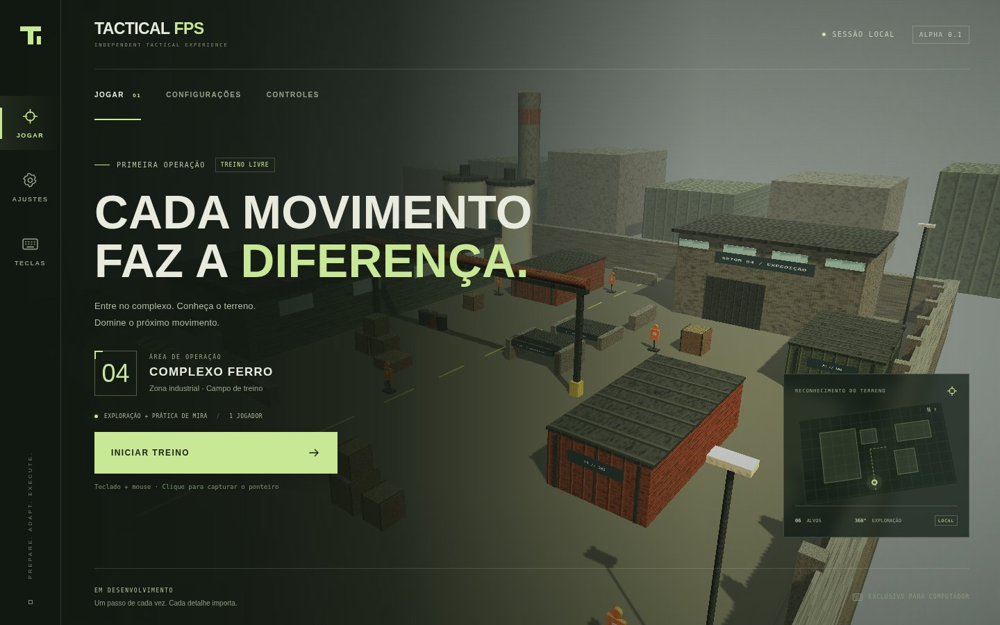
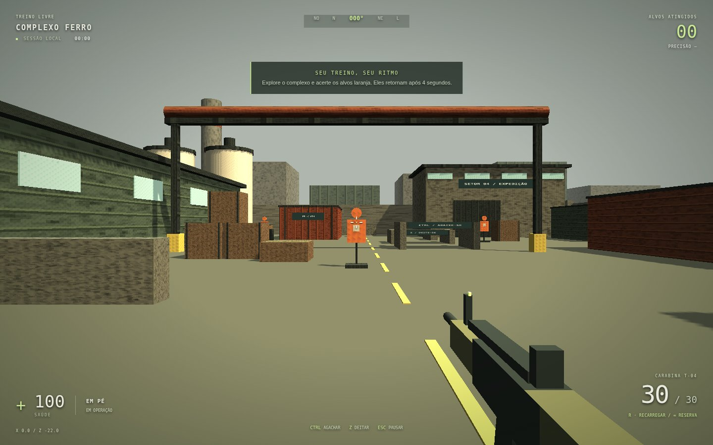

# TACTICAL FPS

**FPS tático 3D para navegadores de computador · Alpha 0.1**

A primeira versão jogável é um campo de treino individual no **Complexo Ferro**, um mapa industrial original. Explore armazéns, contêineres e passagens de manutenção, pratique os movimentos e acerte os seis alvos laranja. Os alvos retornam quatro segundos depois de atingidos.

A direção visual usa geometria simples, texturas de baixa resolução e cores industriais, inspirada na legibilidade dos FPS clássicos como CS 1.6. Cenário, materiais, arma e efeitos sonoros foram criados para este projeto, sem assets desses jogos.

**Exclusivo para computadores:** teclado, mouse e navegador moderno com WebGL/aceleração gráfica. Chrome, Edge e Firefox atuais são os navegadores recomendados; a validação automatizada usa Chromium. Não há versão mobile nem controles de toque.

## Capturas da Alpha





## Executar localmente

Requisitos: **Node.js 22.12+ ou 24 LTS** e npm.

```bash
npm ci
npm run dev
```

Abra o endereço exibido pelo Vite. Entre na conta e clique em **INICIAR TREINO** para capturar o mouse. O bloqueio do ponteiro exige uma interação do usuário e origem segura (HTTPS ou localhost). Pressione **ESC** para liberar o ponteiro e pausar.

```bash
npm test              # Testes unitários de física e configurações
npm run build         # TypeScript + frontend de produção em dist/
npm run preview       # Verificar o build localmente
```

Para testes funcionais no navegador, execute depois do build:

```bash
npx playwright install chromium
npm run test:e2e
```

Em Linux com Chromium já instalado, é possível usar `PLAYWRIGHT_CHROMIUM_EXECUTABLE_PATH=/usr/bin/chromium npm run test:e2e`. Os testes verificam a versão de produção usando WebGL, captura real do ponteiro e eventos reais de teclado/mouse. Os testes de navegador simulam a API Supabase sem enviar e-mails. O jogo real exige uma conta e conexão com Supabase Auth.

## Controles

| Entrada         | Ação                                                  |
| --------------- | ----------------------------------------------------- |
| Mouse           | Olhar / mirar                                         |
| W A S D         | Movimentar                                            |
| Shift + W       | Correr                                                |
| Ctrl            | Alternar agachado / em pé                             |
| Z               | Alternar deitado / em pé                              |
| Espaço          | Saltar; indisponível deitado                          |
| Clique esquerdo | Disparar; segure para fogo automático                 |
| 1 / 2           | Trocar carabina / pistola                             |
| R               | Recarregar (1,7 segundo; reserva ilimitada no treino) |
| Esc             | Pausar e liberar o mouse                              |

Tetos baixos impedem levantar; a postura solicitada é aplicada quando há espaço. As passagens de manutenção sinalizadas permitem praticar agachamento e posição deitado. Caixas baixas podem ser ultrapassadas com salto. A sessão pausa ao perder foco; use **CONTINUAR** para retornar.

O menu de configurações oferece sensibilidade, campo de visão horizontal, volume, qualidade gráfica, inversão vertical e contador de FPS. Os ajustes são salvos na conta; o menu informa sucesso ou falha. A qualidade baixa desativa sombras e reduz a resolução de renderização.

## Publicar o frontend na Vercel

1. Importe `LeonePlays/tactical-fps` na Vercel e escolha a branch desta implementação.
2. Use o diretório raiz do repositório e o preset **Vite**.
3. Comando de instalação: `npm ci`. Comando de build: `npm run build`. Saída: `dist`.
4. Escolha Node.js 22.12+ ou 24 LTS e faça o deploy.

O arquivo `vercel.json` já declara framework, build e diretório de saída. O frontend é estático. Supabase Auth usa a URL e chave publicável de `src/auth/account.ts`, substituíveis por `VITE_SUPABASE_URL` e `VITE_SUPABASE_PUBLISHABLE_KEY`. Nunca coloque uma chave administrativa em variáveis VITE_. A URL HTTPS da Vercel permite WebGL e captura do ponteiro mediante clique. Não abra `dist/index.html` diretamente com `file://`; use um servidor HTTP. O deploy em uma conta Vercel requer que o proprietário conecte o repositório; este código não cria uma conta nem configura credenciais.

## Organização

```text
src/
  core/          Configurações e persistência local
  game/          Cena Babylon.js, mapa, física FPS, arma, áudio e sessão de treino
  ui/            Menus, configurações, ajuda e HUD
  styles/        Estilos da interface de computador
  features/      Contratos para IA, campanha, multiplayer e autenticação
server/          Servidor WebSocket autoritativo para salas locais
public/assets/   Diretórios preservados para mapas, modelos e áudio futuros
  maps/
  models/
  audio/
docs/            Planejamento, decisões e instruções para colaboradores
tests/           Física, configurações e regressões funcionais com Playwright
```

Os antigos arquivos vazios `src/game` e `src/ui` foram convertidos em diretórios com módulos. Nenhum conteúdo de implementação anterior foi removido. Consulte [arquitetura e limites da Alpha](docs/ARCHITECTURE.md) e [contribuição](docs/CONTRIBUTING.md).

## Escopo e planejamento GDD 1.4

O **GDD 1.4 continua sendo a referência de planejamento**. O arquivo `docs/GDD.md` recebido no repositório é um placeholder vazio e foi preservado sem alterações; esta entrega não inventa nem substitui seu conteúdo.

| Disponível nesta Alpha                         | Planejado para etapas seguintes                |
| ---------------------------------------------- | ---------------------------------------------- |
| Campo de treino local em 3D                    | IA de personagens e combate                    |
| Câmera FPS, seis movimentos e colisões         | Campanha e missões narrativas                  |
| Alvos, disparos, recarga e precisão            | Multiplayer por equipes e rodadas              |
| Menu, pausa, HUD, login e configurações online | Histórico completo e progresso de campanha     |
| Frontend estático com configuração Vercel      | Backend, autoridade de servidor e persistência |

O treino individual continua sem dano recebido. Salas locais têm bots/jogadores, dano e reaparecimento; campanha e partidas públicas hospedadas continuam pendentes. No campo de treino a saúde permanece em 100; nas salas a saúde vem do servidor. Os contratos de extensão não simulam funcionalidades que ainda não existem.

## Propriedade intelectual

Copyright © 2026 LeonePlays. **All Rights Reserved — Proprietary Software.** Consulte [LICENSE.md](LICENSE.md). As dependências de terceiros permanecem sujeitas às respectivas licenças.

## Contas e acesso público

O cadastro/login é obrigatório para entrar no treino. Cadastro, recuperação de senha e logout usam Supabase Auth. A confirmação de e-mail deve ser desativada pelo proprietário no painel. Configurações e resumo do último treino (acertos, disparos, duração, data) são pequenos documentos nos metadados da própria conta. Não é necessário SQL. O resumo é salvo ao pausar, reiniciar ou voltar ao menu; fechar abruptamente pode perder a última gravação. Não há histórico completo ou retomada da posição. Resultados são editáveis pelo cliente e não servem para ranking.

O proprietário precisa configurar:

1. Supabase → Authentication → URL Configuration: Site URL para o endereço definitivo; Redirect URLs incluindo esse endereço, preview e `http://localhost:5173/`.
2. Supabase → Authentication: Email habilitado, Confirm email desativado e SMTP próprio para recuperação para envio a usuários públicos. O envio padrão é restrito; a chave publicável não permite alterar essas configurações.
3. Vercel → Settings → Deployment Protection: tornar público o endereço compartilhado ou publicar em produção pública. Verificar em janela anônima que só aparece o login do TACTICAL FPS.
4. Validar com e-mail real: cadastrar, confirmar, entrar, salvar ajustes, entrar em outro navegador e recuperar senha. Testes simulados não comprovam entrega de e-mails.

## Combate e partidas locais

Primária automática e secundária semiautomática têm carregadores independentes, tempos de recarga próprios e troca pelas teclas 1/2. Há recuo de câmera, dispersão por movimento, salto e rajada, mais estabilidade agachado/deitado, clarão e áudio com camada de ruído. A reserva continua infinita no treino. As armas continuam modelos procedurais simples; não são assets realistas finalizados.

**Partidas locais:** crie ou entre numa sala com código, até oito participantes incluindo zero a quatro bots. Há arena compartilhada, dano, morte e reaparecimento controlados por servidor. Consulte [como iniciar e publicar o servidor](server/README.md). O servidor ainda não está hospedado; o preview Vercel sozinho não oferece partidas online.

**Ainda pendentes:** faca, granadas, equipamentos, bomba e melhorias de IA, personagens e sincronização. Salas online exigem servidor de partidas separado da Vercel estática, simulação autoritativa e testes entre clientes; Supabase Auth não substitui esse servidor. Preserve o planejamento GDD 1.4 ao definir essas etapas.

## Login e bots neste computador

Use LOGAR com usuário/e-mail e senha. CADASTRAR solicita e-mail, username (3–20 letras, números ou _) e senha de pelo menos 8 caracteres; ao concluir, volta para LOGAR. A sessão é persistida pelo SDK. Veja [as configurações obrigatórias de contas](supabase/README.md) para desligar confirmação de e-mail e instalar a função de login por username. Não confundir guardar senha no gerenciador Google com login social Google.

O botão **JOGAR COM BOTS NESTE COMPUTADOR** usa a simulação local no navegador e não exige iniciar/hospedar o servidor WebSocket. Escolha a quantidade no seletor Bots. A pausa interrompe essa simulação; salas multiplayer continuam exigindo servidor. Há carabina e pistola nas teclas 1/2, e a arena é distinta do Complexo Ferro do treino. O rodapé mostra `BETA · CONTAS + BOTS LOCAIS · 27/10` para reconhecer a versão atualizada.
