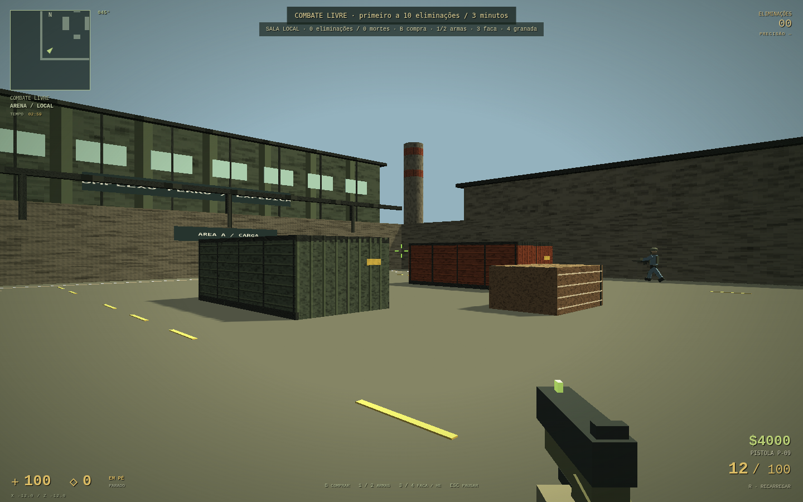

# TACTICAL FPS

**Beta 0.3 · FPS 3D para navegadores de computador.** Jogue como visitante, sem conta Vercel, ChatGPT ou Supabase. Teclado, mouse e WebGL são necessários; não há versão mobile.

A implementação usa TypeScript, Vite e Babylon.js. Movimento, armas, cenários industriais, personagens e áudio são próprios, inspirados nos FPS clássicos. Não é uma reprodução validada 1:1 de CS 1.6. O planejamento GDD 1.4 e `docs/GDD.md` permanecem preservados.



## Jogar

1. Abra o site e clique em **JOGAR AGORA · BOTS**. O padrão é combate livre com três bots.
2. Quando a arena estiver pronta, clique em **ENTRAR NA PARTIDA** para capturar o mouse.
3. Humanos começam com pistola, faca, uma granada e $4000. **B → 1** compra a carabina na área inicial.
4. **ESC** pausa a partida local. Continue, reinicie ou volte ao menu. Ao terminar há resultado e opção de jogar novamente.

Escolha **Bomba** no seletor antes de criar a partida para jogar por equipes. Alpha planta na área A; Bravo impede o plantio ou desarma. **Segure E parado** para interagir. A preparação dura 5 s, a rodada 90 s, o plantio 3 s, o desarme 5 s e a bomba 35 s. Vence quem ganhar três rodadas. Não há reaparecimento durante uma rodada de bomba.

Em **Combate livre**, todos são adversários; a partida termina em 10 eliminações ou 3 minutos, com reaparecimento após 3 s. **INICIAR TREINO** abre o Complexo Ferro, com seis alvos que retornam em quatro segundos e sem dano recebido. A arena dos bots é outro cenário industrial, com colisões compartilhadas com o servidor.

## Controles

| Entrada         | Ação                                     |
| --------------- | ---------------------------------------- |
| Mouse / WASD    | Mirar / correr                           |
| Shift           | Andar silenciosamente                    |
| Ctrl / Z        | Alternar agachado / deitado              |
| Espaço          | Saltar; indisponível deitado             |
| Clique esquerdo | Atirar, golpear ou lançar granada        |
| 1 / 2           | Primária / secundária                    |
| 3 / 4           | Faca / granada HE                        |
| R               | Recarregar com reserva finita            |
| B, depois 1–6   | Comprar arma, munição, colete ou granada |
| E (segurar)     | Plantar, recuperar ou desarmar bomba     |
| ESC             | Liberar mouse / pausar                   |

Há aceleração, atrito, counter-strafing, controle aéreo, colisões por postura, spray determinístico, dispersão por movimento, tempo de troca de armas e impacto nas paredes. A carabina usa 30/90 e a pistola 12/100. Faca tem alcance limitado; granadas colidem, ricocheteiam e causam dano com queda por distância e oclusão das paredes. Equipes não causam dano entre aliados no modo bomba; a própria granada pode ferir quem a lançou.

Bots percebem apenas adversários visíveis, reagem com atraso, contornam obstáculos e seguem o objetivo. Personagens articulados têm postura e caminhada; no modo bomba Alpha usa azul e Bravo laranja. Não há dificuldade selecionável nem animação de qualidade final.

## Executar e verificar

Requisitos: **Node.js 22.12+ ou 24 LTS** e npm.

```bash
npm ci
npm run dev
```

Abra o endereço do Vite. A captura do ponteiro exige clique e origem segura (HTTPS ou localhost). Não abra `dist/index.html` com `file://`.

```bash
npm run format:check
npm test
npm run build
npm run preview
```

Testes funcionais, após o build:

```bash
npx playwright install chromium
npm run test:e2e
# Ou, com Chromium já instalado no Linux:
PLAYWRIGHT_CHROMIUM_EXECUTABLE_PATH=/usr/bin/chromium npm run test:e2e
```

Os testes visitantes usam contexto novo, sem conta ou simulação de autenticação, com Supabase bloqueado. Também há testes de contas com Auth simulado e salas com dois navegadores/servidor isolado; estes não validam o serviço de contas real. Nenhum dado ou credencial de teste habilita autenticação falsa no servidor de produção.

## Contas e dados

**Treino e bots não dependem de login nem de serviços externos.** Ajustes, último treino e último resultado são salvos neste navegador quando o armazenamento está disponível. No modo visitante os dados não migram entre computadores. Não há retomada da posição ou histórico completo de partidas.

**ENTRAR / CADASTRAR** abre o acesso opcional à conta. Cadastro usa e-mail, username (3–20 letras, números ou _) e senha de ao menos 8 caracteres e retorna a LOGAR. A sessão é persistida pelo SDK Supabase; guardar senha no Google Password Manager depende do navegador e não equivale a login com Google. Ajustes e resumos de usuários conectados são salvos nos metadados da conta e não servem para ranking competitivo.

**Pendência externa verificada em 10/11/2026:** o domínio do projeto Supabase fornecido (`rrxwarhfizeuhowqpzle.supabase.co`) retorna NXDOMAIN. Cadastro e login reais precisam de um projeto Supabase ativo. A chave publicável não permite restaurar o projeto nem desligar confirmação de e-mail. Veja [configuração e diagnóstico das contas](supabase/README.md) para atualizar URL/chave na Vercel, desativar confirmação e instalar login por username. O jogo local continua acessível durante essa indisponibilidade.

## Publicar

A Vercel publica o frontend estático; `vercel.json` já define Vite, `npm run build` e `dist`. Conecte este repositório, use Node.js 22 ou 24 e desative Deployment Protection para o endereço compartilhado. Confira em janela anônima. A publicação do frontend não exige login dos jogadores na Vercel ou no ChatGPT.

Variáveis opcionais: `VITE_SUPABASE_URL`, `VITE_SUPABASE_PUBLISHABLE_KEY` e `VITE_MATCH_SERVER_URL`. Use somente chave publicável em `VITE_`; nunca uma chave administrativa.

**Salas entre jogadores** exigem conta real e um processo WebSocket separado. O menu **MULTIPLAYER · SERVIDOR PRÓPRIO** permite criar/entrar por código e misturar jogadores e bots, até oito participantes. O servidor está preparado para execução local e publicação posterior, conforme solicitado. O preview Vercel sozinho não hospeda partidas multiplayer. Consulte [servidor: execução, LAN e publicação](server/README.md). Frontend e servidor usam **protocolo 3** e devem ser atualizados juntos.

## Organização e limites da beta

`src/game/` contém física, armas, equipamentos, navegação, atores, regras de rodada e renderização; `src/network/` compartilha arena/protocolo e transporte local/WebSocket; `src/auth/`, `src/ui/` e `src/core/` cuidam de contas, interface e ajustes. As pastas `server/`, `public/assets/`, `docs/` e `tests/` permanecem preservadas. Veja [arquitetura](docs/ARCHITECTURE.md), [parâmetros do movimento clássico](docs/CLASSIC-FEEL.md) e [contribuição](docs/CONTRIBUTING.md).

Esta beta fecha o ciclo de treino e partidas locais. Campanha narrativa, mapas urbano/porto, matchmaking público, ranking, chat/voz, reconexão com placar e assets/animações finais continuam no planejamento. O multiplayer tem autoridade de movimento/dano/inventário, mas ainda requer hospedagem, validação de carga e melhorias de latência antes de competição pública. Não há promessa de ausência absoluta de bugs.

Copyright © 2026 LeonePlays. **All Rights Reserved — Proprietary Software.** Consulte [LICENSE.md](LICENSE.md). Dependências têm suas respectivas licenças.
