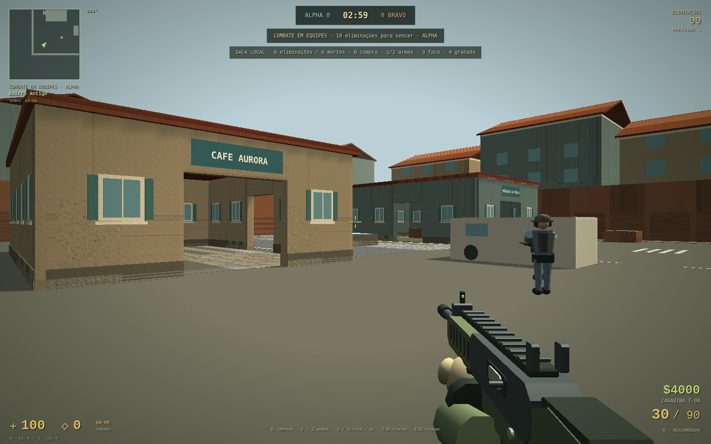

# TACTICAL FPS

**Beta 0.4.1 · FPS 3D para navegadores de computador.** Treino e partidas offline funcionam como visitante, sem conta Vercel, ChatGPT ou Supabase. Requer teclado, mouse e WebGL; não há versão mobile.

A fonte existente usa **TypeScript, Vite e Babylon.js**. O motor foi preservado: na inspeção do repositório disponível, a principal era `tactical-fps`; as branches `main` e `opencode-*` citadas no pedido não apareceram entre as branches acessíveis. Nenhum deployment compilado foi usado como substituto da fonte. O planejamento GDD 1.4, `docs/GDD.md` e as pastas existentes permanecem preservados.

Cenários, texturas, modelos e áudio são procedurais originais, com direção visual inspirada nos FPS clássicos. Não há assets de Counter-Strike/Combat Online nem reprodução validada 1:1 de suas mecânicas.



## Jogar

1. Escolha mapa, modo, quantidade de bots, dificuldade, equipe e limites no painel **CRIAR PARTIDA**.
2. Clique em **CRIAR PARTIDA OFFLINE** ou **JOGAR AGORA · BOTS**.
3. Quando estiver pronta, clique em **ENTRAR NA PARTIDA** para capturar o mouse.
4. **ESC** pausa a simulação offline. Continue, reinicie ou volte ao menu. Ao terminar, confira o resultado e use **JOGAR NOVAMENTE**.

**INICIAR TREINO** mantém o campo individual do Complexo Ferro: seis alvos retornam após quatro segundos, sem dano recebido. Esse campo é separado dos dois mapas de partida.

| Modo                     | Regras reais                                                                                                   |
| ------------------------ | -------------------------------------------------------------------------------------------------------------- |
| Combate livre · FFA      | Todos são adversários; pontuação individual e vencedor por eliminações ou tempo.                               |
| Combate em equipes · TDM | Alpha contra Bravo; pontos da equipe, proteção entre aliados, reaparecimento e resultado por equipe.           |
| Bomba                    | Alpha planta na área A e Bravo impede ou desarma. Preparação, rodadas sem reaparecimento e placar de vitórias. |

FFA/TDM usam **180 s e 10 eliminações** por padrão. Na bomba, o padrão é **90 s por rodada e três vitórias**; a preparação dura 5 s, plantio 3 s, desarme 5 s e o pavio 35 s. **Segure E parado** para plantar, recuperar ou desarmar. O menu aceita duração de 30–1800 s e pontuação de 1–100; na bomba esses campos significam tempo por rodada e vitórias necessárias. FFA/TDM reaparecem após 3 s.

FFA/TDM começam com carabina, pistola, faca, uma HE e $4000. Na bomba, humanos começam com pistola e podem comprar a carabina com **B → 1** na área inicial. Reservas são finitas; a compra também oferece munição e colete.

## Mapas e bots

- **Complexo Ferro — industrial:** arena de 32 × 32 m, módulos de carga, coberturas, sinalização e fábrica ao fundo.
- **Bairro Antigo — urbano:** área de 48 × 48 m, praça, ruas, ruelas, café e mercado acessíveis por várias entradas. Geometria, rotas, iluminação, spawns e objetivo diferem do mapa industrial.

Cada mapa compartilha sua geometria física com navegação e servidor. A escolha carrega outro ambiente, não apenas outro nome ou cor.

Os bots usam grafo de navegação, linha de visão, campo de visão, memória da última posição observada e estados de patrulha, investigação, perseguição, combate, recuo, reagrupamento e objetivo. **Fácil, Normal e Difícil** alteram reação, percepção, giro, erro de mira, cadência e controle do recuo. Cooperação utiliza posições conhecidas de aliados; inimigos ocultos não fornecem posição atual à IA. A aparência identifica Alpha em azul e Bravo em tons de ferrugem nos modos por equipe.

## Controles

| Entrada         | Ação                                                     |
| --------------- | -------------------------------------------------------- |
| Mouse / WASD    | Olhar / movimentar                                       |
| Shift           | Andar silenciosamente                                    |
| Ctrl            | Correr enquanto a tecla estiver pressionada              |
| C / Z           | Alternar agachado / deitado                              |
| Espaço          | Saltar; indisponível deitado                             |
| Clique esquerdo | Atirar, golpear ou lançar HE                             |
| Clique direito  | Mirar enquanto o botão estiver pressionado               |
| 1 / 2           | Primária / secundária                                    |
| 3 / 4 / 5       | Faca / granada HE do slot 1 / granada HE do slot 2       |
| 6               | Bomba, quando estiver carregando no modo de objetivo     |
| Scroll do mouse | Percorrer armas e equipamentos disponíveis               |
| R               | Recarregar com reserva finita                            |
| B, depois 1–6   | Comprar arma, munição, colete ou granada                 |
| E               | Usar/interagir; recuperar equipamento próximo            |
| E (segurar)     | Plantar ou desarmar bomba                                |
| F               | Ligar/desligar lanterna                                  |
| Q               | Largar o equipamento selecionado; a faca é permanente    |
| Tab (segurar)   | Placar com jogadores, bots, equipes e resultados atuais  |
| ESC             | Liberar mouse / pausar                                   |
| T / Y           | Chat global / da equipe, somente em sala online          |
| H               | Ajustes rápidos, somente para o anfitrião de sala online |

Agachar e deitar são alternáveis. A corrida exige estar em pé; Shift tem prioridade para caminhar silenciosamente. Os slots de granada carregam HE; não há granadas de fumaça ou luz nesta versão. Chat e ajustes do anfitrião dependem de um servidor de partidas compatível iniciado; não enviam mensagens no modo offline.

Movimento inclui aceleração, atrito, counter-strafing, controle aéreo, posturas, colisões e subida de degraus baixos de até 0,30 m. Armas têm recuo, dispersão por movimento, tempo de troca, recarga e impactos. A HE ricocheteia e causa dano com queda por distância e oclusão das paredes; pode ferir quem a lançou.

## Ajustes e perfil

Sensibilidade, FOV, volume geral, efeitos, música ambiente do menu, qualidade, escala de resolução, sombras, inversão vertical, mira dinâmica e FPS são configuráveis. Tela cheia depende do suporte/permissão do navegador. Opções de escala e sombras alteram o renderer; não há promessa de 60 FPS em hardware não medido.

Ajustes, configuração da partida, nome de visitante e último resultado são guardados no navegador quando o armazenamento está disponível. O perfil local não cria uma conta e não migra dados entre computadores. HUD, notificações e resultado derivam do estado da partida; não há servidores ou jogadores humanos simulados na lista online.

## Executar e verificar

Requisitos: **Node.js 22.12+ ou 24 LTS** e npm.

```bash
npm ci
npm run dev
```

Abra o endereço exibido pelo Vite. A captura do ponteiro exige clique e origem segura (HTTPS ou localhost). Não abra `dist/index.html` com `file://`.

```bash
npm run format:check
npm test
npm run build
npm run preview
```

Testes de navegador, após o build:

```bash
npx playwright install chromium
npm run test:e2e
# Ou com Chromium já instalado no Linux:
PLAYWRIGHT_CHROMIUM_EXECUTABLE_PATH=/usr/bin/chromium npm run test:e2e
```

A suíte cobre física, mapas, navegação, dificuldades, armas, regras, configuração e protocolo. Os testes visitantes usam contexto novo sem autenticação simulada e bloqueiam Supabase. Testes de conta e salas têm fixtures isoladas; não comprovam o serviço de contas real. Consulte [a verificação dos controles 0.4.1](docs/QA-0.4.1.md) e [a verificação da base 0.4](docs/QA-0.4.md) para comandos, resultados e limites.

## Contas e multiplayer

**Treino e bots são independentes de login e serviços externos.** **ENTRAR / CADASTRAR** é opcional para o jogo local. A conta real usa Supabase; cadastro solicita e-mail, username e senha e retorna a LOGAR. Sessão persistente e salvamento online dependem desse serviço.

No último diagnóstico registrado, em **10/11/2026**, `rrxwarhfizeuhowqpzle.supabase.co` retornava **NXDOMAIN**. O código não restaura esse projeto: cadastro/login real exige projeto ativo e configuração correta. Veja [contas e diagnóstico](supabase/README.md) para URL/chave publicável, confirmação de e-mail e função de username. Nunca coloque chave administrativa em variáveis `VITE_`.

**ENCONTRAR SERVIDORES** consulta `/rooms` do servidor informado e permite criar/entrar por código. É uma lista real das salas desse processo, não matchmaking público. Salas entre jogadores exigem conta válida e um servidor Node/WebSocket separado; até oito participantes incluindo bots. O anfitrião pode reiniciar e configurar a sala com H; a função passa a outro humano conectado quando ele sai. T abre o chat da sala e Y limita as mensagens aos colegas de equipe. [Execução, LAN e publicação do servidor](server/README.md).

Frontend e servidor devem ser atualizados juntos, pois a versão do protocolo é verificada ao conectar. O servidor está preparado para execução local e publicação posterior; a Vercel estática não hospeda esse processo.

## Publicar e manter

`vercel.json` define preset Vite, `npm run build` e saída `dist`. Use Node.js 22 ou 24. O endereço compartilhado precisa estar publicamente acessível; confirme em janela anônima. Nenhuma conta Vercel ou ChatGPT é necessária para jogar.

Variáveis opcionais: `VITE_SUPABASE_URL`, `VITE_SUPABASE_PUBLISHABLE_KEY` e `VITE_MATCH_SERVER_URL`. Use somente chave publicável no frontend. Publicar o frontend não publica automaticamente o servidor ou configura Supabase.

Os módulos ficam em `src/game/` (simulação, mapas, IA e renderização), `src/network/` (protocolo e transportes), `src/ui/` (interface e apresentação), `src/core/` (relógio e ajustes) e `src/auth/`. `server/`, `public/assets/`, `docs/` e `tests/` foram preservados. Consulte [arquitetura](docs/ARCHITECTURE.md), [histórico](docs/CHANGELOG.md), [próximas etapas](docs/NEXT-STEPS.md) e [contribuição](docs/CONTRIBUTING.md).

Campanha narrativa, porto, matchmaking público, ranking validado, chat de voz e reconexão com placar continuam planejados. Multiplayer ainda requer hospedagem, testes de carga e refinamento de latência antes de competição pública. Esta beta não promete ausência absoluta de bugs.

Copyright © 2026 LeonePlays. **All Rights Reserved — Proprietary Software.** Consulte [LICENSE.md](LICENSE.md). Dependências preservam suas licenças; Babylon.js é Apache-2.0, e Vite, Supabase JS e ws usam MIT.
