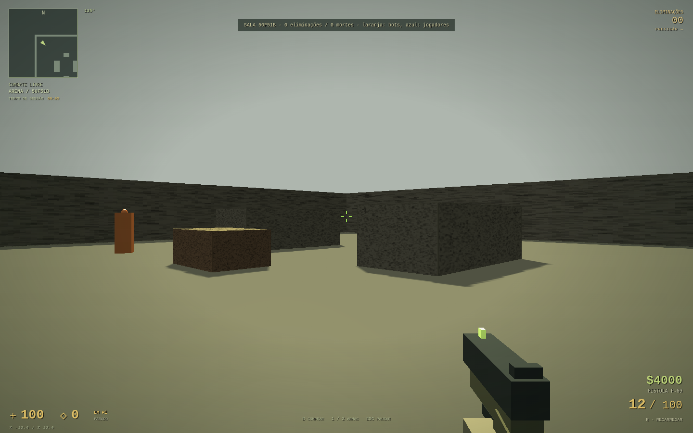

# TACTICAL FPS — movimento, tiro e HUD clássicos (0.2)

## Diagnóstico da base recebida

Comparação com o commit `243a7ec`:

| Antes                                                                | Implementação atual                                                              |
| -------------------------------------------------------------------- | -------------------------------------------------------------------------------- |
| Deslocamento horizontal instantâneo por tecla                        | Velocidade X/Z, aceleração por projeção, atrito e frenagem por comando contrário |
| Controle no ar substituía a direção/velocidade imediatamente         | Momento horizontal preservado e aceleração aérea limitada pela projeção          |
| Recuo lateral com `Math.random()` e câmera permanentemente deslocada | Curvas de spray reproduzíveis, punch separado da mira e recuperação após soltar  |
| Precisão baseada apenas em tecla pressionada                         | Cone baseado na velocidade real, postura, estado aéreo e rajada                  |
| Recarga criava munição; troca fixa em 0,25 s                         | Carregadores/reservas finitos, recarga com transferência, deploy por arma        |
| Tiro/recarga duplicados entre Game e Match                           | Um `WeaponController` usado por treino, bots locais e servidor                   |
| HUD grande de treino e reserva infinita                              | HUD compacto: radar, cruz, vida/colete, dinheiro, munição e compra numerada      |
| Sem marcas de disparo/passos                                         | Pool de 64 impactos e efeitos Web Audio originais, com ruído reutilizado         |

A stack permanece TypeScript + Vite + Babylon.js; autenticação, pastas de assets e GDD 1.4 foram preservados. O nome continua TACTICAL FPS. Não é necessário migrar para Three.js/Canvas para obter essas mecânicas. Canvas 2D é usado somente no radar.

## Referência e limite de fidelidade

Referência técnica consultada: [SDK público da Valve, `pm_shared.c`](https://github.com/ValveSoftware/halflife/blob/master/pm_shared/pm_shared.c), funções `PM_Accelerate`, `PM_AirAccelerate` e `PM_Friction` (consulta em 03/11/2026). O SDK de Half-Life estabelece a base de movimento GoldSrc; não comprova igualdade de todas as regras específicas do CS 1.6. Esta é uma implementação própria das fórmulas, sem incorporar código, mapas, modelos ou sons dos jogos da Valve.

No chão:

```text
control = max(velocidade, min(stopSpeed, velocidade máxima da postura))
velocidade *= max(0, velocidade - control * friction * dt) / velocidade
currentSpeed = dot(velocidadeHorizontal, wishDirection)
addSpeed = max(0, wishSpeed - currentSpeed)
velocidadeHorizontal += wishDirection * min(addSpeed, acceleration * wishSpeed * dt)
```

No ar não se aplica atrito do chão. `addSpeed` usa `min(wishSpeed, airWishCap)`; a parcela de aceleração continua usando `wishSpeed` sem esse cap, como na fórmula do SDK. Isso permite air-strafe sem substituir a velocidade por um vetor escolhido pelo jogador. O limite de segurança para velocidade aérea total é separado.

O mínimo de atrito é limitado pela velocidade máxima da postura para preservar o movimento deitado, uma extensão própria que não faz parte do CS 1.6. A colisão continua AABB, em terreno plano: faltam hull tracing, rampas, step-up automático, edge friction, escadas e regras completas de bunny hop. Não há medição lado a lado com o executável original; não declarar fidelidade 1:1.

## Parâmetros para ajuste

`src/game/physics.ts` usa metros e segundos; o perfil adota escala de **0,0254 m por unidade de referência**.

| Parâmetro                    | Valor                         |
| ---------------------------- | ----------------------------- |
| Corrida padrão               | 6,35 m/s (250 unidades/s)     |
| Shift: andar silenciosamente | 3,302 m/s (130 unidades/s)    |
| Agachado / deitado           | 2,117 / 1,15 m/s              |
| Aceleração no chão / no ar   | 5 / 10                        |
| Atrito / stop speed          | 4 / 1,905 m/s (75 unidades/s) |
| Air wish cap                 | 0,762 m/s (30 unidades/s)     |
| Gravidade / impulso de salto | 20,32 m/s² / 6,8 m/s          |
| Subpasso máximo de colisão   | 1/120 s                       |

`MovementInput.sprint` permanece como nome legado no código, mas agora representa **Shift/andar**, inclusive no protocolo. Atualize os dois lados juntos. Velocidade é normalizada na diagonal. A câmera continua recebendo deslocamentos relativos do mouse com pointer lock; o recuo é somado à rotação visual, sem alterar a mira base enviada ao servidor.

## Armas, reserva e precisão

| Arma própria  | Carregador / reserva inicial máxima | Cadência                         | Recarga | Deploy |
| ------------- | ----------------------------------- | -------------------------------- | ------- | ------ |
| Carabina T-04 | 30 / 90                             | 0,10 s (600 RPM)                 | 2,45 s  | 1,00 s |
| Pistola P-09  | 12 / 100                            | 0,15 s (400 RPM), semiautomática | 2,20 s  | 0,75 s |

Os valores e sprays são um perfil ajustável de armas próprias; não são padrões extraídos de AK/USP originais. `ballistics.ts` contém curvas determinísticas e dispersão com semente. `weapons.ts` controla cadência, deploy, recarga, inventário e recuperação. Segurar a pistola não produz fogo automático. Cliques/reloads rápidos têm sequências persistentes para não desaparecer entre ticks do servidor. Trocar cancela a recarga sem criar munição; uma nova troca para a arma já equipada não reinicia o deploy.

A mira dinâmica mostra a expansão de precisão. É possível desativá-la nas configurações e usar cruz fixa; isso não muda a precisão física. Contraesterçar reduz a velocidade mais rapidamente que só soltar a tecla, e por consequência reduz o cone de disparo.

Decalques são marcas cosméticas previstas pelo cliente: no multiplayer, o resultado válido de dano/acerto vem exclusivamente do servidor. O pool comporta 64 marcas com duração de 20 segundos da simulação local. Sons são sintetizados e originais. Passos são emitidos por distância percorrida em corrida; Shift/agachado/deitado silenciam os passos locais. Não há ainda reprodução espacial dos passos de outros jogadores.

## HUD e compra

- Radar norte acima: terreno próximo, direção do jogador e contatos a até 12 m sem parede bloqueando a linha horizontal. É um radar de treino/combate livre, sem equipes ou compartilhamento de informação entre aliados.
- Vida, colete, dinheiro, carregador/reserva e tempo **decorrido de sessão**, sem simular um cronômetro de rodada que ainda não existe.
- **B** abre/fecha a compra enquanto o mouse continua capturado. As teclas **1–5** selecionam itens; fora da compra, **1/2** trocam arma. ESC libera o mouse e fecha a compra. Os comandos são por teclado, conforme indicado no painel.
- Área de compra: raio de 6 m do nascimento, primeiros 90 s da sessão/vida. Treino individual começa com as duas armas e $16000. Arena inicia com pistola e $4000; carabina custa $2700. Bots usam carabina. Eliminação concede $300 (limite $16000). Colete custa $650 e absorve parte do dano até acabar.
- O servidor valida saldo, propriedade da arma, área, tempo e sequência da compra. Repetir o mesmo pacote não cobra/concede de novo. Dinheiro e inventário de partida não são persistidos no Supabase.

A arena continua sendo combate livre com reaparecimento; equipes, rodadas, economia por rodada, bomba, faca e granadas não foram implementadas nesta alteração.

## Aplicação segura

1. Preserve suas alterações locais. Use a branch **`feat/classic-game-feel`**, derivada de `243a7ec`. Aplique o conjunto completo: `physics.ts`, `ballistics.ts`, `weapons.ts`, `shop.ts`, integração de `game.ts`/`match.ts`, protocolo, HUD e estilos. Copiar apenas `physics.ts` deixa chamadores/testes antigos com semântica incorreta.
2. Na raiz do repositório, com Node 22.12+ ou 24:

   ```bash
   npm ci
   npm test
   npm run build
   npm run dev
   ```

3. Entre com a conta existente. No treino individual, teste WASD (correr), Shift (andar), Ctrl/Z, salto, soltar A e pressionar D para frear, tiro parado/em movimento, R, 1/2 e B. O fluxo Supabase não foi alterado por esta entrega. Veja `supabase/README.md` para os ajustes administrativos ainda pendentes.
4. Para bots individuais, use **JOGAR COM BOTS NESTE COMPUTADOR**; o modo não exige servidor WebSocket. Para salas, em outro terminal:

   ```bash
   npm run server
   ```

5. Regressão no navegador depois do build:

   ```bash
   npx playwright install chromium
   npm run test:e2e
   # Linux, se houver Chromium do sistema:
   PLAYWRIGHT_CHROMIUM_EXECUTABLE_PATH=/usr/bin/chromium npm run test:e2e
   ```

6. Publique frontend **e servidor juntos**: o protocolo agora é **2** e `/health` informa a versão. Conexões incompatíveis são rejeitadas com mensagem, em vez de aplicar snapshots antigos ao HUD novo. Treino/bots locais não dependem desse servidor. O frontend continua Vite/dist na Vercel; o servidor exige processo persistente e WSS em HTTPS, conforme `server/README.md`.
7. Para comparar ou voltar à base sem modificar a produção, mantenha esta alteração em branch/PR e use o checkout da branch anterior após guardar suas alterações. Não é necessário apagar pastas, trocar engine ou reconfigurar a autenticação.

## Verificação e próximos critérios

Testes cobrem aceleração e diagonal, atrito, counter-strafe, ar, colisões/tetos/deitado, deslocamento a 30/144 Hz, direção/spray determinísticos, cadência, clique semiautomático, conservação de munição, cancelamento de recarga, deploy, compras duplicadas e validação de área/saldo. Testes de navegador exercitam o HUD, reserva, compra, impactos, armas e dois clientes WebSocket. Eles simulam apenas Auth: não comprovam login/e-mails reais nem o deploy remoto.

Para afirmar fidelidade maior ao CS 1.6 ainda é necessário gravar trajetórias e sprays de referência, calibrar em uma escala de mapa fixa, comparar tempos/velocidades e validar a sensação com jogadores. Modelo visual e teste aprovado não substituem essa comparação.

### Resultado local desta entrega

Passaram **39 testes unitários/integração**, **11 testes de navegador** (Chromium com WebGL), `npm run build` e `npm run format:check`. A captura abaixo foi feita numa sala com dois navegadores e bots, com autenticação simulada somente no teste. O resultado não comprova CI/deploy remoto nem equivalência medida com o CS 1.6.


